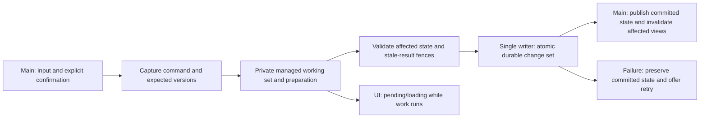

# Architecture and performance implementation plan

Approved direction: 2026-10-20. **Planning only; no refactor or PR merge is performed by this document.**

2026-10-23 review update: [Save/state/memory refactor and Luna-medium agent breakdown](SAVE_STATE_REFACTOR_PLAN.md) maps this direction to current code, bounded parallel assignments and ordered checkpoints. Its S00 re-establishes current integration/PR history rather than assuming the historical branch status below is still current. The new plan is for review only; no refactor execution is authorized by its delivery.

## Authority, entry point and execution rules

- Source discussion: [Architecture Performance Audit](chatgpt-conversation://6ad757e8-0078-83e9-bff3-f132902df1a6). Its recovered user questions request fewer redundant atomic actions, less object duplication and JSON conversion, incremental processing, a better SQLite structure, explicit worker boundaries, and loading states when necessary. Assistant replies were returned as unresolved content references. The user subsequently **explicitly validated the reconstructed direction in this repository chat**, including the storage and thread boundaries below; this plan does not pretend to quote the unavailable tables.
- Code baseline: local `main` at `1a295a2`. Reviewed PR: [#4](https://github.com/desapoint/DragLab/pull/4), head `1ac43ccfc97e6efba865b472e50e3adc1de7eedc`, common base `d69490f9dad417e0f2706c97801dcebdae5c85e4`.
- Decision: **finish the validation of PR #4, merge it first, then refactor from updated main.** Preserve its reusable fitment index. Do not build a competing market rewrite on the old main or expand the F.7 branch into a transaction/database overhaul.
- PR #4 remains draft until checkpoint AP-00 passes. A clean merge and passing domain tests do not prove improved frame pacing. This plan is not authorization to mark an untested gate complete or silently merge.
- **Next implementation checkpoint: AP-00 only.** The present planning checkpoint does not start it automatically. See the [PR review](../reports/architecture-performance-20261020/PR4_REVIEW.md).
- Work in the existing checkout; no worktree. After AP-01, use updated main as the base for subsequent work. Preserve unrelated local changes and desktop F8, mobile native-only behavior, current controls, and the debug benches.
- Execute one checkpoint at a time. For rows containing several commands, give each command a separate suffix/checkpoint and stop after the first; the row is not blanket authorization to convert the whole family. Record checks, locally commit explicit paths, report the result, and **wait for explicit user validation** before advancing. Technical completion and user acceptance are separate fields.
- If a step reveals an unmeasured prerequisite, record it and revise that step before enlarging its scope. No big-bang rewrite, simultaneous persistent authorities, or speculative worker migration.

## Approved outcome

The game keeps one authoritative in-memory ownership/state model with stable identities. Read-only views and indexes reuse that state. A confirmed command prepares a private working set for the affected records, validates its dependencies, and persists one atomic change set. Publication happens on main only after durable success. Safe expensive preparation can run on isolated managed data while the interface remains responsive.

Small actions should scale primarily with the affected records and required dependencies. Adding unrelated inventory or market rows should not force a full profile clone, JSON encode/decode, repeated full ownership normalization, complete SQL relationship scan, or unrelated physics recalculation.

Authored vehicle/part/career definitions remain editable project content. Settings remain separate recoverable files. SQLite owns persistent player state; simulation ticks and UI gestures do not query or write it. Complex, cold payloads may retain JSON where useful. The goal is to remove unnecessary whole-state conversion, not to forbid every serialization or every safety snapshot.

**Serialized writer** means ordered database operations through one controlled writer. It does not mean JSON-serializing the entire profile. **Fewer atomic actions** means one commit for one confirmed logical action, such as an entire cart or batch repair. It does not mean weaker durability, saving each item independently, or combining unrelated user actions without their semantics being preserved.

## Progress verified against code

| Concern | Current main | Contribution of PR #4 | Remaining direction |
| --- | --- | --- | --- |
| Authored compatibility | Cached catalogue/product/category layouts already exist | Adds ordered model-to-product fitment indexes and reuses them in initial/final new-stock and used-stock guarantees | Retain; do not use model fitment as a substitute for installed-build/position compatibility |
| Market workers | Isolated new-supply work and staged finish settlement already exist | Removes additional repeated compatibility scans from that path | Measure remaining main-thread capture/publication and cold misses separately |
| Object duplication | Detached catalogue copies and private profile copies remain at several boundaries | Shares its completed fitment index; does not remove the other copies | Reuse genuinely immutable authored views by content revision, with private mutable resolver/simulation scratch state |
| Owned inventory lookup | Many `Find`, `Any` and owner/slot scans remain | None | Transient identity, location and ownership indexes |
| Ordinary transactions | `MechanicsTransactions.Try` JSON-clones the whole profile and calls full `Ensure` before and after the operation | None | Scoped command working sets, explicit read/write sets and targeted validation |
| Save preparation | `CaptureManaged` serializes the full profile; `StateRows` reparses/projects it, with reuse of unchanged chunks | None | Project only changed records directly |
| SQL persistence | WAL/FULL, migrations, commit fences, changed state rows and relational ownership constraints already exist | None; no migration | Keep safeguards, eliminate whole-table relationship diff work, evolve hot records deliberately |
| Transaction UI latency | Ordinary `TrySaveCore` waits for its worker with `GetAwaiter().GetResult()`; finish settlement is already asynchronous | None | One pending-command coordinator with durable acknowledgement and responsive UI |
| Derived results | Several bounded caches and physical fingerprints already exist; global profile revisions still invalidate broader contexts | None | Dependency-specific invalidation and reuse of unaffected results |
| Save recovery | Legacy import, migrations, backups, reset floors and race resource checkpoints already exist | No persistence change | Preserve all of them throughout migration |

Relevant code: `MechanicsTransactions.cs`, `ProfileStore.cs`, `ProfileStore.Pending.cs`, `SqliteStateStore.cs`, `StateRows.cs`, `SharedInventory.cs`, `MechanicsOwnership.cs`, `PrototypeGame.FinishSettlement.cs`, `RuntimeIndexSlot.cs`, and `NativePartPreviewCache.cs`. Paths are under `Game/Assets/DragLab/Scripts/` in their existing Domain/Infrastructure/Runtime folders.

## Proposed boundaries

Preparation may be synchronous when cheap. Worker count and frame budgets must be measured on Android; extra tasks are not automatically faster. Keep active simulation ownership on its established thread until a separate, specifically tested change proves otherwise.

| Feature / current methods | Main-thread responsibility | Worker responsibility / eligibility | Reason and boundary |
| --- | --- | --- | --- |
| UI Toolkit, dialogs, input and native view publication | Yes | None | Unity-owned UI and input; retain drafts, explicit Apply, held pedals and current styling |
| `Resources.LoadAll`, authored assets and catalogue construction | Asset access and capture | Only detached managed preparation | Constructors/helpers must not indirectly access Unity assets from a worker |
| `MarketCatalogLayout.GetSteps`, `FitmentIndex` in PR #4 | Capture, validate revision, publish completed view | Build/read immutable managed index | Authored revision only; never cache live stock or owner state in it |
| `PartsMarket.RefreshSteps` / `NewPartSupply` | Coordinate private candidate and final publication | Seeded selection, coverage and quantity preparation on detached data | Preserve RNG order, actual used coverage, wear, holds and complete-epoch publication |
| `MechanicsOwnership.Resolve` | Capture authoritative fitted build | Future pure managed resolution only after call-graph audit | Existing helpers include copying/serialization; do not assume the entire Domain folder is worker-safe |
| `CarInspection`, dyno and quarter-mile previews | Snapshot/version capture and display | Isolated read-only calculations | Reuse per-build results; discard stale work rather than publishing it |
| `SharedInventory.Entries`, identity/slot lookups | Query completed in-memory indexes | Workers receive immutable views if needed | No SQL or full clone for a normal inventory read |
| `MechanicsTransactions.Try` | Legacy fallback until replaced per command | New planners may prepare private managed changes | No worker mutates live profile; no shallow copy passed to a mutating full normalizer |
| `MechanicsOwnership.Ensure` / migrations | Existing Unity-dependent normalization | Only audited detached work | Split initialization/migration from routine commands; preserve removal/fault history |
| `MechanicsOwnership.Validate` | Cheap command/version checks and error presentation | Complete snapshot validation already used in settlement; later targeted validation | Keep full load/migration validation and prove targeted rules against it |
| `ProfileStore.TrySaveCore` | Current call is blocking; future enqueue/publication only | SQL work currently runs on a task | Calling a worker and immediately waiting still blocks UI |
| `BeginValidatedSave` / `CaptureManaged` / `StateRows` | Capture required Unity/main-owned values | Captured managed projection/encoding | Replace global JSON projection with changed-record DTOs; retain safe fallback during transition |
| `SqliteStateStore.Write` / `Sync` | None during ordinary frame execution after conversion | Single ordered writer, prepared statements and commit | Preserve commit tokens, foreign keys, WAL/FULL and failure recovery |
| Backups / reset / import / migrations | Explicit lifecycle orchestration | Storage I/O under controlled ownership | Preserve reset floors; never restore pre-reset assets or replace player state with defaults |
| Race input, active `CarSimulation`, visual interpolation | Keep established ownership | Separate read-only preview/market jobs only | Do not repeat the earlier broad simulation/Unity threading regression |
| Race checkpoints and result settlement | Capture monotonic tick/resources, schedule, publish | Ordered persistence and isolated preparation | Newer shutdown wear/checkpoints must survive settlement; exactly one payout |
| Audio callbacks | Existing dedicated DSP path | No new generic jobs, locks or I/O in callback | Keep reusable buffers; background workload must not starve Android audio |

## Storage evolution

Keep SQLite. SQL indexes do not accelerate `List.Find` in the in-memory simulation; those need runtime indexes. Moving all authored content into the save database is not part of this plan.

| Record family | Intended representation | Migration / design condition |
| --- | --- | --- |
| Save metadata and migration history | Retain independent schema, build, content and physics versions | Existing migration checksums remain immutable; append ordered migrations |
| Cars, engines and components | Stable ID records, typed frequently queried ownership/location fields, explicit installed-slot relations | Extend existing `owners`, `components`, `installed_slots` where appropriate; avoid duplicate canonical ownership tables |
| Individual members | Stable member ID, parent part, position/role, definition, condition and fault state | Do not average tires/pistons or lose mixed specifications, history or quantities |
| Stock | Seller/epoch/product identity plus directly changeable quantity/reservation fields | Retain exact discovery, initial quantities, delivery percentages and canonical aliases |
| Market epoch metadata | Seed, generation, refresh progress and immutable offer/quote metadata | Preserve three-race refresh and nine-race cart reservations; no implicit reroll |
| Reservations and cart | Explicit held units, source epoch/stock and expiry, with command dependencies | Partially stocked purchases must preserve stocked/express split and fees |
| Money and progression | Typed balances/counters and idempotent receipts for confirmed commands | One atomic balance/stock/ownership/result change; no duplicate charges or rewards after retry/restart |
| Fuel, fluids, wear and faults | Directly changeable state keyed by actual owning identities | Preserve monotonic usage and checkpoint ordering; no normalization healing |
| Saved tuning, complex cold metadata and exceptional payloads | Versioned structured payloads, with JSON where appropriate | Encode only affected payloads, not the entire profile |
| Authored definitions and settings | Existing project content and separate preference files | No per-save catalogue duplication or progression reset deleting preferences |

Do not undo existing market chunking by creating a row for every generated cold nested field. Benchmark a hybrid: hot quantities/holds/condition in direct records, cold bulk metadata in bounded payloads. Missing/default stock rows must have explicitly tested semantics, including express quotes and discovery history; sparse storage must not silently invent or discard data. No indefinite dual-write design with two authoritative copies of the same field.

## Checkpoint sequence

All implementation steps below are **not started by this planning delivery**. Validation work performed for this review is recorded separately; passing existing tests is not acceptance of the following refactor.

| ID | One bounded deliverable | Required evidence before commit / stop |
| --- | --- | --- |
| **AP-00** | Finish PR #4 acceptance | Rebuild the combined current-main/PR player; controlled baseline/candidate comparisons with the same starting state, seed, epoch, wear, holds, content, opportunity count and frame pacing. Include cold/warm runs and several repeats. Investigate the fitted-parts first-launch test failure without weakening assertions. Separate publication, checkpoint retirement, UI rebuild and worker costs. Retain domain/save and held-writer gates. Record pass/fail and material limits. |
| **AP-01** | Merge only the validated PR into current main | Recheck reviewed head/base SHAs, merge/additive history, retain current audio/UI fixes and unrelated files. Rerun affected integration gates and build the merged Windows checkpoint. Verify branch is main. Do not delete other branches or push without the applicable user authorization. Stop for acceptance. |
| **AP-02** | Establish the post-merge transaction baseline | Trace a refill, stocked/partially express checkout, batch replacement, inventory move and paid-third settlement in fixed disposable saves. Break down capture, clone, normalization, lookup, operation, projection, SQL, durable flush, publication, UI invalidation, queue wait and GC allocations. Record 1/5/20-car and increasing inventory/market sizes, cold/warm samples and frame percentiles. Define performance budgets from this evidence, not one historical sample. |
| **AP-03** | Add transient ownership/inventory indexes | Part/car/engine/member by stable ID; slots, owner/location and dealer/stock lookup where needed. Use the existing index-lifetime infrastructure. Prove results and duplicate/orphan rejection match authoritative scans. Index validity must cover mutations inside a candidate, not just a revision increment at transaction end. Workers get completed read-only snapshots. No save-format change. |
| **AP-04** | Define commands, change sets and dependency versions | Define expected ledger/storage versions, operation ID, read set, write set and affected aggregates. Distinguish physical state, commerce state, catalogue, presentation and preferences for invalidation. Define ownership of shared immutable authored snapshots versus private per-job resolver/simulation scratch. Keep all current callers on the existing safe path; no behavioral migration yet. Test stale-result rejection and complete dependency capture. |
| **AP-05** | Finish dependency-specific view/cache invalidation | One cache/view type per accepted suffix. Unrelated cash, names, records or cart changes retain physical inspections. Wear, fluids, fitted hardware, supported tune and relevant content changes invalidate them. Reuse immutable authored views where measured duplication warrants it; do not share mutable resolver caches accidentally. Rebuild only affected view rows/derived values; retain navigation defaults. Bound caches and pending batches; cancellation and stale results cannot starve or overwrite current work. Audit the separate stat-cache branch before reusing it; it is not PR #4. |
| **AP-06** | Convert one fluid refill to a scoped working set | First pilot: fuel refill or one explicitly selected fluid service, not every purchase. Copy only mutable affected state; keep committed source unchanged. Targeted validation must agree with full validation in isolated shadow tests. Do not call global mutating `Ensure` over shared objects. Preserve price, capacity, quantities, consumption history, failures and rollback. |
| **AP-07** | Persist the pilot through direct row deltas | Write/project only affected records using the existing schema first where feasible. Remove full-profile JSON encode/parse and whole-table ownership synchronization from the pilot. Update cached rows/digests only after durable commit. Prove exact logical reload against the old path and crash/failed-write behavior. No schema rewrite merely to rename records. |
| **AP-08** | Make the pilot command nonblocking | One command coordinator and ordered writer; UI remains responsive with existing pending/loading visuals. Block conflicting mutations and duplicate confirms, preserve drafts, reject stale pre-commit work. A durable commit must be reconciled even if the view closes before publication. Separate settings must not be overwritten by an older pending progression candidate. Test held writer, retry, cancel/navigation, suspend and restart. |
| **AP-09** | Convert cart checkout, one coherent command | One change set for the whole confirmed cart. Retain actual member/corner identities, partial local stock, express shortages/fees, reservation lifetimes and removed originals. No per-line save or early stock publication. Compare against existing checkout and exercise failure before/after durability. Reservation-edit conversion is a separate suffix if required. |
| **AP-10** | Convert batch maintenance | Start with Replace broken **or** Replace under X%, as one suffix/checkpoint. Reuse cart/stock/express planning rather than a competing purchase engine. Retain exact selections and the common slider/dialog. One confirmation, one transaction; no refresh/rebuild while dragging. Convert the other action only after acceptance. |
| **AP-11** | Convert inventory/workshop commands incrementally | One command per suffix: move, individual replacement, rebuild, prepared-engine swap, or sale. Preserve topology, compatible member constraints, fluids, faults and exclusive ownership. Keep full isolation/rollback comparisons until each command's old adapter can be removed safely. |
| **AP-12** | Convert remaining state-changing commands | One suffix per tuning Apply, saved-setup load, car purchase/sale, race entry, business claim or reset command. Preserve explicit confirmation, quotes and all existing resource/progression rules. Never treat this row as permission to convert every subsystem at once. |
| **AP-13** | Review the concrete typed SQLite schema | Produce a field/authority inventory, proposed table/constraint/index map, actual query plans and migration/rollback fixtures. Identify the first hot record family from AP-02/06 measurements. Explicitly decide what stays in JSON/chunks. Review before any migration implementation; no automatic conversion of every payload. |
| **AP-14** | Migrate one approved hot record family | Append one versioned migration with backup, transactional conversion, validation and old/new logical parity. Start with the family approved in AP-13. Preserve all IDs, ordinals with domain meaning, stock/discovery/fees, balances, faults, resources and settings. Update/reset/recovery paths and future-version refusal. Each later family is a separate suffix with approval. |
| **AP-15** | Unify checkpoint/result persistence with the command pipeline | Reuse existing staged settlement; do not replace physics. Preserve monotonic tick/resource merging and exact-once reward receipts. A commit may retire only checkpoints it includes; later shutdown wear/fuel must remain recoverable. Preserve every seeded market/used-stock fingerprint and atomic epoch publication. Test writer contention and exit before rival finish. |
| **AP-16** | Remove superseded compatibility work | Only after all migrated callers pass: remove their global clone/JSON bridge, unnecessary normalizers, redundant index rebuilds and obsolete dual paths. Keep explicit load/import/migration validation and independent regression references needed to prove correctness. Update the architecture/storage documents to the actual implemented contract. |
| **AP-17** | Validate the resulting Windows and Android checkpoint | Real transaction/navigation/finish traces; long-session growth, memory and allocations; background-job contention with audio and touch. Compare equal workloads to AP-02, test durability/recovery/suspend and held throttle across shifting. Build both targets and test a real phone when available. Record technical results separately from user acceptance. |

### AP-00 branch decision gate

Chosen order is **merge-first, then broader refactor**. Current main remains intact while reviewing. A clean mechanical merge and isolated fitment-index CPU savings are insufficient to mark AP-00 complete. If matched tests uncover a real regression, fix only that PR defect and rerun this gate; do not bury it under a broad refactor. Reconfirm the live PR head before AP-01 because a later update invalidates an earlier review.

Use the existing `NewSupplyVerify`, `PartsMarketVerify`, `SqliteStateVerify`, packaged `MarketBaselineOnly` and `FinishPacingOnly` gates. Their historical invocation recipes are in `reports/market-refresh-audit/CHECKPOINT-F7.md` on the PR. The benchmark must also pin its input state; setting target FPS alone is not a matched workload. A source-only/headless pass is not a packaged-player frame test.

### Common acceptance contract

- Every definitive action preserves all-or-nothing money, ownership, stock, reservations and resources. No success acknowledgement before durable commit; no duplicate outcome after retry or restart.
- No UI, sorting, preview, filter or slider gesture writes progression. Settings remain drafts until explicit confirmation.
- No cache stores mutable live state across a worker boundary. Cancellation/stale candidates never publish. Authored and physical compatibility remain distinct.
- Full state validation stays at load/import/migration and existing safe fallbacks. Targeted validators replace routine full passes only after equivalence and corruption tests establish the invariants they cover.
- No artificial frame yielding to make a stopwatch look better. Measure CPU, wall latency, frame tails, allocations and queue wait separately. Worker CPU can rise while UI responsiveness improves; both must be disclosed.
- Initial cooperative work-budget target is roughly 2–3 ms per main-thread chunk, subject to AP-02 measurements. Indivisible work can exceed it and must be measured. No universal zero-hitch or Android performance claim is implied.
- Preserve the same authoritative simulation in race and bench. Do not recalibrate rewards, wear, grip, market probabilities or sounds to make a performance test pass.

## Checkpoint ledger

| Checkpoint | Technical status | User acceptance |
| --- | --- | --- |
| Direction and this plan | Direction explicitly confirmed in the current chat; document delivery recorded in Git | Direction approved; implementation steps require their own validation |
| PR #4 review | Source/integration review and focused domain/save gates recorded in the review report; matched packaged performance remains pending | Not accepted for merge by silence or by this table |
| AP-00 through AP-17 | Pending as individual implementation checkpoints | Not granted in advance |

At each accepted checkpoint, append its commit, exact checks/build, measurements, limitations, and explicit user acceptance here or in a linked report. Update **Next implementation checkpoint** at the top only after the preceding gate is satisfied.
