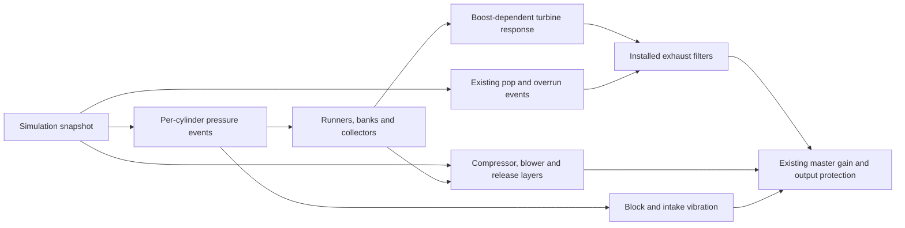

# Engine audio: pressure events within the existing pipeline

## Acoustic extension, 2026-10-20

The firing scheduler advances once per PCM frame. Independent left/right header
signals feed separate collector histories, resonances, pressure-dependent turbine
filters and installed exhaust chains. A bounded crossfeed keeps both banks audible
on either speaker; inline engines use one centered path. Mono output folds the
final stereo pair down without doubling firing events. The live silent clock clip
is stereo so Unity supplies both channels to the callback.

Pulse tables now use smoothed actual cylinder load plus pedal/boost excitation.
Turbo hot-side damping interpolates precomputed light/heavy filter responses with
existing turbo pressure and actual normalized mass flow. No new spool, boost,
thermal, wear or power simulation is introduced.

`EngineSoundSpec.acoustics` provides Automatic / Compact / ClassicV8 / ModernV /
HighRev / Diesel presets. Automatic selects by actual cylinder layout/count,
fuel system and redline; displacement scales the runners. Optional overrides:

| Field | Meaning / supported range |
| --- | --- |
| `runnerLengthsMetres` | One 0.1–2 m length per cylinder; overrides generated lengths |
| `runnerScale` | Generated runner length scale, 0.5–2 |
| `collectorScale` | Collector reflection travel-time scale, 0.5–2 |
| `resonanceScale` | Header/body resonance frequency scale, 0.5–2 |
| `attackScale`, `blowdownScale`, `rarefactionScale` | Pulse envelope time scales, 0.5–2 |
| `stereoWidth` | Bank separation, 0–1; inline engines remain centered |
| `turbineDamping` | Maximum pressure/flow-dependent hot-side acoustic blend, 0–0.8 |

These are acoustic authoring controls, not measured exhaust dimensions or a CFD
model. Playback captures immutable runner/envelope values. Shared tables are keyed
by rate **and envelope**, with at most 16 retained entries; uncommon/custom voices
still own prepared tables for their lifetime. Coefficients, histories and tables
are prepared before playback, with no callback allocation or Unity calls.

Sound Settings adds **Compressor airflow**, 0–100%, using the shared slider and
explicit confirmed Apply. Zero removes compressor airflow hiss while retaining
shaft whistle, exhaust/turbine response, BOV releases and supercharger whine.
`EngineSoundSpec.compressorNoiseGain` additionally sets an authored 0–2 multiplier.
Legacy preferences lacking the field use 100%. Unrelated/pause preference commits
preserve the applied value. DSP reads a published float and smooths changes;
it performs no preference I/O.

[Builds, checks, measured cost and listening review](../reports/audio-refinements-20261020/CHANGES.md).

User direction, 2026-10-19: integrate the reviewed pressure core across the current
engine roster. Retain the existing audio architecture, wear, cuts, exhaust upgrades
and induction sounds. Add missing acoustic detail from the supplied turbo script;
do not replace or simplify the existing induction simulation.

## Simulation stays authoritative

`InductionDynamics` retains size-dependent spool/coast, exhaust-energy and load
response, unit flow capacities, compressor efficiency, charge temperature,
intercooling, backpressure loss, twin-turbo factors, supercharger drive losses,
series twincharging/bypass and pressure-release events. That implementation and
the engine/vehicle physics are unchanged by this audio checkpoint.

`EngineSoundController` publishes immutable RPM, throttle, load, per-cylinder
contribution, combustion/cut state, turbo spool/boost, blower boost/drive load,
release/pop counters and actual intake mass flow. DSP never writes physics,
health, resources or gameplay RNG. The Python demo's turbo-state integrator,
scripted rev trajectory and independent recording normalization are not runtime
simulation or gain controls.

## Audio path

The source uses the current mechanical firing order and actual cylinder identity.
Current inline engines share one collector bank; the current crossplane V8 uses
odd/even banks. No random missing combustion, fake limiter event, shifted RPM or
healed cylinder is introduced. Synthetic 1-16-cylinder/layout combinations are
stress coverage, not additional authored engines or measured real-world geometry.

## Turbo additions

| Detail | Added acoustic response |
|---|---|
| Exhaust/turbine interaction | Pressure-derived lower-mid turbine texture; boost/load affect pulse strength and runner arrival |
| Compressor layering | Shaft-following fundamental/blade partials, two filtered airflow bands, size-dependent acoustic pitch |
| Boost-dependent exhaust | Smooth pressure-dependent hot-side damping and pulse character; use turbo boost separately from blower pressure |

Actual mass flow includes the simulation's existing density, temperature, capacity
and wear constraints. Audio-only smoothing interpolates snapshots; it does not
reintegrate a competing shaft, manifold or boost state. Hardware counts, blower
ratios and current blow-off valve modes remain supported. These remain authored
acoustic approximations, not CFD or measured turbo blade geometry.

## Runtime preparation and Android

Pulse tables are shared by sample rate with a bounded cache. Voice filters,
reflection/ring buffers and coefficients are prepared before playback. Live
`EngineAudio` sessions prepare only the device's rate. A device-rate change is
published on the main thread while retaining the controller and current snapshot;
the callback silences any intervening mismatched block. It does not allocate or
construct tables from the audio thread.

The public synth keeps prepared 44.1/48 kHz compatibility for existing offline
callers. Other rates must be prepared explicitly before `Fill`; supported rates
are 8-192 kHz. Development players expose callback timing counters without adding
a new user-facing interface. Physical Android profiling remains distinct from
desktop/Editor timing and successful ARM64 compilation. See the checkpoint report
for the checks and build evidence actually obtained.
