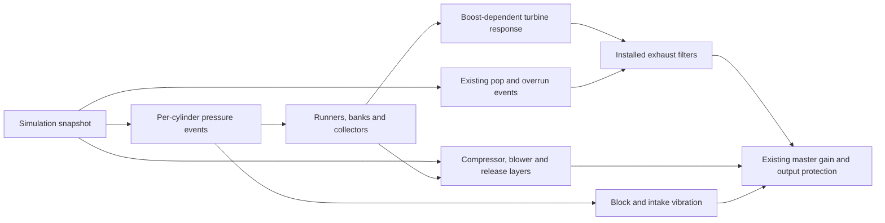

# Engine audio: pressure events within the existing pipeline

## Acoustic extension, 2026-10-20

The firing scheduler advances once per PCM frame. Independent left/right header
signals feed separate collector histories, resonances, pressure-dependent turbine
filters and installed exhaust chains. A bounded crossfeed keeps both banks audible
on either speaker; inline engines use one centered path. Mono output folds the
final stereo pair down without doubling firing events. The live silent clock clip
is stereo so Unity supplies both channels to the callback.

Pulse tables now use smoothed actual cylinder load plus pedal/boost excitation.
Turbo hot-side damping interpolates precomputed light/heavy filter responses with
existing turbo pressure and actual normalized mass flow. No new spool, boost,
thermal, wear or power simulation is introduced.

`EngineSoundSpec.acoustics` provides Automatic / Compact / ClassicV8 / ModernV /
HighRev / Diesel presets. Automatic selects by actual cylinder layout/count,
fuel system and redline; displacement scales the runners. Optional overrides:

| Field | Meaning / supported range |
| --- | --- |
| `runnerLengthsMetres` | One 0.1–2 m length per cylinder; overrides generated lengths |
| `runnerScale` | Generated runner length scale, 0.5–2 |
| `collectorScale` | Collector reflection travel-time scale, 0.5–2 |
| `resonanceScale` | Header/body resonance frequency scale, 0.5–2 |
| `attackScale`, `blowdownScale`, `rarefactionScale` | Pulse envelope time scales, 0.5–2 |
| `stereoWidth` | Bank separation, 0–1; inline engines remain centered |
| `turbineDamping` | Maximum pressure/flow-dependent hot-side acoustic blend, 0–0.8 |

These are acoustic authoring controls, not measured exhaust dimensions or a CFD
model. Playback captures immutable runner/envelope values. Shared tables are keyed
by rate **and envelope**, with at most 16 retained entries; uncommon/custom voices
still own prepared tables for their lifetime. Coefficients, histories and tables
are prepared before playback, with no callback allocation or Unity calls.

Sound Settings adds **Compressor airflow**, 0–100%, using the shared slider and
explicit confirmed Apply. Zero removes compressor airflow hiss while retaining
shaft whistle, exhaust/turbine response, BOV releases and supercharger whine.
`EngineSoundSpec.compressorNoiseGain` additionally sets an authored 0–2 multiplier.
Legacy preferences lacking the field use 100%. Unrelated/pause preference commits
preserve the applied value. DSP reads a published float and smooths changes;
it performs no preference I/O.

[Builds, checks, measured cost and listening review](../reports/audio-refinements-20261020/CHANGES.md).

User direction, 2026-10-19: integrate the reviewed pressure core across the current
engine roster. Retain the existing audio architecture, wear, cuts, exhaust upgrades
and induction sounds. Add missing acoustic detail from the supplied turbo script;
do not replace or simplify the existing induction simulation.

## Simulation stays authoritative

`InductionDynamics` retains size-dependent spool/coast, exhaust-energy and load
response, unit flow capacities, compressor efficiency, charge temperature,
intercooling, backpressure loss, twin-turbo factors, supercharger drive losses,
series twincharging/bypass and pressure-release events. That implementation and
the engine/vehicle physics are unchanged by this audio checkpoint.

`EngineSoundController` publishes immutable RPM, throttle, load, per-cylinder
contribution, combustion/cut state, turbo spool/boost, blower boost/drive load,
release/pop counters and actual intake mass flow. DSP never writes physics,
health, resources or gameplay RNG. The Python demo's turbo-state integrator,
scripted rev trajectory and independent recording normalization are not runtime
simulation or gain controls.

## Audio path

The source uses the current mechanical firing order and actual cylinder identity.
Current inline engines share one collector bank; the current crossplane V8 uses
odd/even banks. No random missing combustion, fake limiter event, shifted RPM or
healed cylinder is introduced. Synthetic 1-16-cylinder/layout combinations are
stress coverage, not additional authored engines or measured real-world geometry.

## Turbo additions

| Detail | Added acoustic response |
|---|---|
| Exhaust/turbine interaction | Pressure-derived lower-mid turbine texture; boost/load affect pulse strength and runner arrival |
| Compressor layering | Shaft-following fundamental/blade partials, two filtered airflow bands, size-dependent acoustic pitch |
| Boost-dependent exhaust | Smooth pressure-dependent hot-side damping and pulse character; use turbo boost separately from blower pressure |

Actual mass flow includes the simulation's existing density, temperature, capacity
and wear constraints. Audio-only smoothing interpolates snapshots; it does not
reintegrate a competing shaft, manifold or boost state. Hardware counts, blower
ratios and current blow-off valve modes remain supported. These remain authored
acoustic approximations, not CFD or measured turbo blade geometry.

## Runtime preparation and Android

Pulse tables are shared by sample rate with a bounded cache. Voice filters,
reflection/ring buffers and coefficients are prepared before playback. Live
`EngineAudio` sessions prepare only the device's rate. A device-rate change is
published on the main thread while retaining the controller and current snapshot;
the callback silences any intervening mismatched block. It does not allocate or
construct tables from the audio thread.

The public synth keeps prepared 44.1/48 kHz compatibility for existing offline
callers. Other rates must be prepared explicitly before `Fill`; supported rates
are 8-192 kHz. Development players expose callback timing counters without adding
a new user-facing interface. Physical Android profiling remains distinct from
desktop/Editor timing and successful ARM64 compilation. See the checkpoint report
for the checks and build evidence actually obtained.

## Category isolation and tire acoustics, 2026-10-20

Production engine and tire AudioSources have independent published category gains,
multiplied by master gain in their existing smoothed DSP paths. Opponent gain and
distance attenuation still apply to both rival voices. Legacy settings default
both categories to 100%; normal and pause controls remain drafts until Apply.
The development live audition solos engine or tires without changing preferences.

Tire contact remains authoritative: each corner supplies slip work, effective
friction, normal load and rolling radius. A prepared immutable acoustic profile
adds that corner's fitted compound grip and front/rear width multiplier. Wider
patches and softer compounds gently lower/broaden rubber resonance and alter its
roughness/squeal mix. This is sound calibration, not a measured rubber acoustics
model or a change to handling. One explicit Asphalt sound surface is defined;
there is no surface selector or extra surface-dependent physics. Profiles are
prepared outside the audio callback, which retains reusable buffers and filters.

Per-tire isolation follow-up: the four voices read FL/FR/RL/RR contact independently.
A planted corner contributes zero slip audio even if another wheel spins or the
car's aggregate slip remains high. Existing release envelopes briefly decay if a
previously slipping tire regains grip. Left/right pan follows corner side; the
silent clock is stereo to preserve this in Unity. One AudioSource mixes the four
independent voices; mono output is still supported. The synthetic aggregate-slip
fallback belongs to the acoustic bench and does not replace initialized road
contacts. Open-differential single-wheel coverage is part of the live audition.

## Requested afterfire direction — preview stage, 2026-10-20

The user rejected ringing pops, then louder short cracks that sounded like breaking
material. Larger overrun afterfires need a separate pressure/burning-gas envelope
with a rolling decay; do not simply amplify or stretch every limiter crack.
The current longer-envelope and source-location studies are Editor-only listening
prototypes. Production `ExhaustPopSynth`, event generation, physics and builds are
unchanged. No preview has received listening approval.

The production simulation currently publishes a pop count and strength. It has
carburetor-transient, ignition-cut, two-step and anti-lag triggers, but does not
publish the cause, combustion location, trapped fuel/oxygen or local exhaust gas
temperature for an individual event. Carburetor intake combustion must eventually
be distinguished from exhaust afterfire rather than automatically sharing the same
exhaust outlet path. Do not describe an inferred source location as simulated.

Required integration contract after sound approval:

- Capture event cause, strength/available combustion energy and source region in
  the authoritative model. Distinguish limiter cuts, overrun, anti-lag and genuine
  fault-related events; fuel-cut behavior must not invent unburned fuel.
- Installed fueling/ignition hardware, mixture, timing, faults, preceding load,
  airflow/boost and fuel properties affect event formation through that model.
  Capture existing values rather than creating a competing audio-side engine.
- Use authored ordered exhaust geometry and fitted hardware: manifolds/collectors,
  turbine where present, catalyst, pipe length/diameter, resonators, silencers and
  outlet. Event sound is injected at its source, with downstream transmission and
  upstream reflections; do not repeatedly filter it through components behind it.
  Apply turbine damping only when the propagation path crosses the turbine.
- Gas conditions affect propagation and losses. Installed component condition can
  change leakage, damping or rattles only when supported by an actual modeled fault;
  healthy parts must not gain a generic breakage sound.
- Keep limiter cracks short while allowing separately accumulated afterfire energy
  a broader pressure bloom and turbulent decay. Long events overlap using bounded
  prepared voices. Use subtle repeatable variation without changing event timing,
  adding random explosions, or creating a sustained pitched bell.
- Prepare routing, coefficients and reusable buffers outside the callback; preserve
  Android constraints, category gains, stereo banks, cuts and normal engine audio.

The present prototype uses actual pop strength, displacement, airflow, boost and
existing pop gain/shape controls, plus the fitted silencer transfer and exhaust
upgrade level. Its source location, path lengths and 650 K gas assumption are
explicit audition inputs, not measured geometry or new physical state. A partial
silencer transfer approximates a source inside it. This is a direction comparison,
not a full bidirectional wave or nonlinear exhaust-combustion model. The Bison
fixtures have one silencer and no turbine/catalyst; these previews cannot validate
missing hardware paths or correct event-cause classification.

Acoustic references for the future component model: [COMSOL's automotive muffler
model](https://doc.comsol.com/6.4/doc/com.comsol.help.models.mph.automotive_muffler/automotive_muffler.html)
demonstrates chamber-dependent transmission loss and gas-property inputs;
[the perforated-muffler model](https://doc.comsol.com/6.4/doc/com.comsol.help.models.aco.perforated_muffler/perforated_muffler.html)
explains the limitations of linear approximations. Preview coefficients are our
listening calibration and are not fitted to those reference models.

## Shared-source audition authorized — 2026-10-20

The user clarified that a single parameter-driven sound generator should cover
all combustion-event shapes, then authorized a controlled listening matrix before
game integration. This supersedes separate short/long generators as the intended
final architecture. Different event causes provide numerical inputs and source
locations; they do not select different canned source algorithms.

The Editor-only `SharedBackfirePreviewSynth` implements that prototype with
fuel/oxygen-limited energy, pressure/turbulence envelopes and prepared bidirectional
duct propagation. `SharedBackfireAudition` provides one engine-plus-events WAV for
each of 34 hardware/geometry configurations using the same sixteen-chapter flow.
The four-second chapters include controls, hard/soft fuel and ignition limiting,
two-step, shifts, overrun, source-location comparisons, anti-lag and faults.
Source-location comparisons retain the same event seed and combustion parameters.

The existing production synth supplies the engine bed with only its old pop layer
disabled on a private copy. No runtime source, physics, saves or builds are changed.
Lab-supplied energy/chemistry/source coordinates and geometry are not purported
existing race-state measurements. See [scope, evidence and listening protocol](../reports/shared-backfire-audition-20261020/CHANGES.md).
Wait for explicit acoustic approval before adding the event metadata and integrating
this shared core with runtime audio and Android performance gates.

### Bison pressure-front calibration review

The user found the shared Bison chambered-exhaust sample too air-like and requested
five WAV-only generator versions using the full existing sequence. Optional prepared
source calibration now adjusts pressure, turbulence, a smoothed pressure-rise front
and expansion response. The default path remains sample-identical; this is one
shared numerical source, not cause-specific sound algorithms. The five calibrations
are isolated listening candidates, with no runtime or old-matrix change. See
[parameters and checks](../reports/bison-backfire-versions-20261020/CHANGES.md).
No HTML page is created or updated for this request. Wait for explicit listening
approval before selecting any calibration for the game.

### Actual high-event Tempest comparison, still preview-only

Following the user's request for more real events and an unchanged game reference,
the new Tempest free-flow/ignition-cut/two-step/anti-lag audition uses a fresh actual
race input replay. The production reference is checked sample for sample; all five
alternatives share its real published triggers and dry engine bed. No artificial
pop schedule or changed production sound is introduced.

The optional common source can now use a normalized heat-release pulse, a lumped
pressure/discharge state, pressure-driven turbulence and a damped body-response
proxy. Fast combustion rise is distinct from the longer release/propagation tail.
The engine's existing vibration bed remains independent. Fuel/oxygen/source/gas
packets are still inferred audition inputs because the runtime does not publish
them; this is not a fully coupled physical combustion/engine/exhaust solver.
Default source behavior remains unchanged. [Assumptions, reference and five WAV
options](../reports/tempest-backfire-comparison-20261020/CHANGES.md). No HTML, runtime
integration or platform build; wait for acoustic approval.

### Sharper attack and longer decay listening revision

The Tempest reference and captured event packets are held identical while five
revised previews use shorter internal heat release, faster front smoothing and
less turbulent noise. An optional prepared pressure-fed exterior reflection
network extends the decay separately from the combustion attack. Its environment
is a calibrated audition assumption; no production hardware/engine filtering is
bypassed and no runtime sound is changed. [Parameters and preservation checks](../reports/tempest-backfire-sharp-20261020/CHANGES.md).
Deliver direct WAVs for listening approval; do not advance AP-00 or integrate yet.

### Exhaust-wall texture audition on preferred sharper versions 4 and 5

The user prefers the direction of 4 and 5 but requests crackle/resonance from
exhaust vibration. Optional surface-weighted duct-pressure excitation now drives
three broad low-Q wall modes and a mild nonlinear flex residual. This is an
assumed shell-radiation proxy, not measured material/mount/contact dynamics or
new backfire events. Five preview-only variants preserve the original reference,
captured sequence, engine and all other version-4/5 voicing parameters. Defaults
retain prior output. [Parameters, limitations and checks](../reports/tempest-backfire-texture-20261020/CHANGES.md).
Deliver WAVs for listening; runtime integration and AP-00 remain held.

### Isolated pressure-source comparison before further texture work

The user found the latest wall variants too similar and approved three isolated,
loudness-matched examples (sharp snap, ragged release, fuller bang), followed by
those same sources through one identical chambered exhaust. This is a source-shape
listening experiment with explicitly inferred heat-release tables, not game audio
integration or a real-vehicle accuracy claim. Constant-gain matched delivery and
independent common-exhaust convolution keep the comparison controlled.
[Setup, limits and verification](../reports/isolated-backfire-sources-20261020/CHANGES.md).
Only six WAVs are delivered; wait for acoustic approval before integration.

### Supplied final V8 generator: C# preview matrix before integration

The user prefers the Graph Backfire Sounds final light-cleanup / less-ticking
source and requires the equivalent in C#, with only backfire generation changing.
The complete acoustic source/seed/path model is ported to Editor-only C# and
reuses the game's fitted `ExhaustFilter`. Actual Unity engine/controller/physics
captures provide unchanged engine beds and physical triggers. Each full case plays
original → light cleanup → less ticking, including exact fuel/diesel quiet controls.
Python and supplied reference code remain local and are not versioned dependencies.
[Model, variables, seed streams, gates and limits](../reports/v8-backfire-matrix-20261020/CHANGES.md).
Wait for explicit listening confirmation before runtime integration, platform
build/profiling or architecture-plan work. Engine/induction/cut/wear DSP is intact.

### Causality/detail audit before backfire integration

The user requires audio events to follow the simulation, with consistent detail
and explicit validation across combustion, induction, exhaust and tires. The
[2026-10-20 audit](../reports/audio-causality-20261020/CHANGES.md) distinguishes
state-driven behavior, calibrated acoustic response and missing physical state.
The new preview is a better waveform model, not a replacement for backfire
occurrence physics. Runtime pops still use edge/timer requests, lack transported
fuel/oxygen/ignition-site state and can coalesce on publication. These remain open
integration blockers. Do not describe behavioral DSP checks as physical accuracy.

A narrow runtime guard now prevents fresh requests from failed/stalled or
supply-unavailable engines and rejects non-finite strengths. No new generator or
other engine/induction/tire sound change is integrated. The audit defines a
timestamped event/mixture/path contract and negative cases for the next backfire
checkpoint; acoustic acceptance and Android device profiling remain separate.

### Mixture-conditioned event preview and separate engine ringing

The user identifies the Timber ding in the unchanged engine-only layer. Private
intake/clatter ablations investigate it without modifying engine DSP. The new
[mixture preview checkpoint](../reports/mixture-backfire-20261020/CHANGES.md) keeps
the reviewed backfire timbre and replaces the preview's old counter-driven event
schedule with transported residual fuel/oxygen, heat exchange, dilution/flammability
gates and conditional seeded ignition. Every reaction consumes retained material;
fuel cut supplies no new fuel but can leave earlier mixture to burn.

Ten complete original → new comparisons and negative controls pass. This is a
reduced-order Editor experiment with explicit estimated burn/thermal/geometry
inputs, not new real-world accuracy certification or runtime integration. Engine
audio, induction, tires and race results remain unchanged. The intake tone has
not been silently removed from gameplay, nor has a shell variant been selected
as a supposed fix for a sound confirmed to exist in the engine layer.
