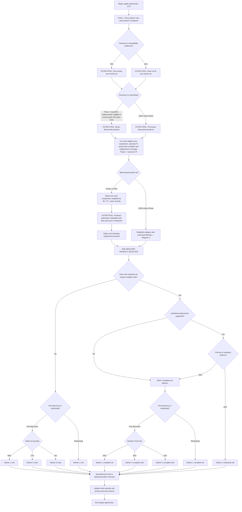
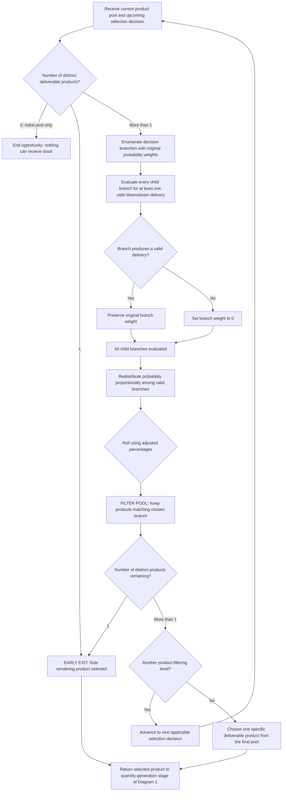

# Seeded new-parts supply — approved specification

Recorded 2026-10-18 from the user's three Mermaid flows and subsequent explicit wear/coverage rules. Implemented after mobile clipping checkpoint acda6c8. This document remains the approved behavior contract; technical evidence and remaining acceptance limits are recorded in reports/new-parts-supply/CHANGES.md.

**Scope clarification:** all three selection flows, compatibility/discovery/category probabilities, additive stock and first-discovery/restock quantity rules apply exclusively to **new parts**. Do not apply them to used-part or complete-engine supply. Preserve the used market's existing selection probabilities, opportunity/quantity budgets, quantities, wear/fault generation, guarantees, expiration and reservations. Changing or accumulating new inventory must not indirectly increase/reweight the used pool through its former new-stock-count dependency. Generate used stock through its preserved independent behavior first; the new-part priority calculation only reads qualifying available used coverage. Validate this separation explicitly.

## Supply opportunity

One opportunity selects one distinct new-part product from the authored catalogue, then adds a seeded delivery to that product's inventory. Equivalent catalogue aliases are one product; individual used listings are not new products. Repeat for each opportunity i of N.

Discovery history must persist independently from current stock: selling out does not make a product undiscovered. Restocking adds to current inventory. No new value for N was specified in these messages; retain the established opportunity budget unless a separately approved decision changes it. Preserve existing reservation lifetimes, express fees and refresh cadence except where the explicitly additive stock/discovery rules supersede the old new-stock reroll.

## Branch validation at every product-selection level

Validate all downstream constraints before rolling; never choose an empty branch and retry with an unweighted fallback. Redistribute proportionally over valid original weights. A sole remaining product skips further product-filtering rolls but still receives normal quantity generation. Initial empty pool ends the opportunity. If no eligible worn replacement remains after prior filters, wear probability is zero and normal category selection receives 100%.

## Category and exact-part weights

Use the original numerical weights below; displayed percentages are rounded explanations, not independently normalized constants. Unavailable branches are removed and remaining weights normalized at each level.

```mermaid
flowchart TB
    START["POOL = Remaining candidates from main flow"]
    START --> GROUP{"Weighted category group"}
    GROUP -->|"17.91% · weight 3.0"| IND{"Induction"}
    GROUP -->|"17.91% · weight 3.0"| TIRE{"Tires"}
    GROUP -->|"14.93% · weight 2.5"| AIR{"Intake / fuel / exhaust"}
    GROUP -->|"11.94% · weight 2.0"| DRIVE{"Drivetrain"}
    GROUP -->|"11.94% · weight 2.0"| ENGINE{"Engine / electronics"}
    GROUP -->|"10.45% · weight 1.75"| SUPPORT{"Wheels / cooling / lubrication"}
    GROUP -->|"8.96% · weight 1.5"| BRAKES["FILTER POOL: Brakes"]
    GROUP -->|"5.97% · weight 1.0"| BODY{"Body / interior / accessories"}
    IND -->|"65%"| TURBO{"Turbo family"}
    IND -->|"25%"| SUPER{"Supercharger family"}
    IND -->|"10%"| FACTORY["FILTER POOL: Factory induction variants"]
    TURBO -->|"33.33% each"| TURBOP["FILTER ONE: Turbo / TwinTurbo / Twincharged"]
    SUPER -->|"50% each"| SUPERP["FILTER ONE: Supercharger / TwinSupercharger"]
    TIRE -->|"20%"| STREET{"Street tire family"}
    TIRE -->|"30%"| RADIAL{"Drag radial family"}
    TIRE -->|"50%"| SLICK{"Competition slick family"}
    STREET -->|"33.33% each"| STREETP["FILTER ONE: OEM / Touring / StreetSemiSlick"]
    RADIAL -->|"50% each"| RADIALP["FILTER ONE: EnduranceRadial / ProRadial"]
    SLICK -->|"33.33% each"| SLICKP["FILTER ONE: SlickMedium / SlickSoft / QualifyingSlick"]
    AIR -->|"40%"| HEAD["FILTER POOL: HeadIntake"]
    AIR -->|"30%"| FUEL["FILTER POOL: FuelSystem"]
    AIR -->|"30%"| EXHAUST["FILTER POOL: Exhaust"]
    DRIVE -->|"25%"| GEAR["FILTER POOL: Gearbox"]
    DRIVE -->|"20%"| COUPLE{"Clutch / flywheel"}
    DRIVE -->|"20%"| DIFFER{"Differential family"}
    DRIVE -->|"15%"| SHAFT{"Driveshaft family"}
    DRIVE -->|"20%"| AXLE{"Axle / transfer case"}
    COUPLE -->|"50% each"| COUPLEP["FILTER ONE: Clutch / Flywheel"]
    DIFFER -->|"33.33% each"| DIFFERP["FILTER ONE: Differential / FrontDifferential / RearDifferential"]
    SHAFT -->|"33.33% each"| SHAFTP["FILTER ONE: Driveshaft / FrontDriveshaft / RearDriveshaft"]
    AXLE -->|"33.33% each"| AXLEP["FILTER ONE: FrontAxle / RearAxle / TransferCase"]
    ENGINE -->|"35%"| CORE{"Core engine"}
    ENGINE -->|"30%"| VALVE{"Valvetrain"}
    ENGINE -->|"20%"| IGN{"Ignition / controls"}
    ENGINE -->|"15%"| ELECT{"Electronic accessories"}
    CORE -->|"16.67% each"| COREP["FILTER ONE: Pistons / Rods / Crankshaft / CylinderBlock / PistonRings / Bearings"]
    VALVE -->|"16.67% each"| VALVEP["FILTER ONE: Camshaft / ValveSprings / Valves / Followers / TimingDrive / ValveSeals"]
    IGN -->|"25% each"| IGNP["FILTER ONE: Ignition / SparkPlugs / GlowPlugs / Controls"]
    ELECT -->|"33.33% each"| ELECP["FILTER ONE: RevLimiter / ShiftLight / TwoStep"]
    SUPPORT -->|"35%"| WHEELS["FILTER POOL: Wheels"]
    SUPPORT -->|"40%"| COOL{"Cooling parts"}
    SUPPORT -->|"25%"| OIL{"Lubrication parts"}
    COOL -->|"20% each"| COOLP["FILTER ONE: Cooling / CoolantPump / CoolingCap / CoolingHoses / OilCooler"]
    OIL -->|"33.33% each"| OILP["FILTER ONE: OilPan / OilPump / OilFilter"]
    BODY -->|"50%"| BP["FILTER POOL: Body"]
    BODY -->|"25%"| INTERIOR["FILTER POOL: Interior"]
    BODY -->|"25%"| ACCESS["FILTER POOL: Accessories"]
    TURBOP & SUPERP & FACTORY --> FINAL
    STREETP & RADIALP & SLICKP --> FINAL
    HEAD & FUEL & EXHAUST --> FINAL
    GEAR & COUPLEP & DIFFERP & SHAFTP & AXLEP --> FINAL
    COREP & VALVEP & IGNP & ELECP --> FINAL
    WHEELS & COOLP & OILP --> FINAL
    BRAKES & BP & INTERIOR & ACCESS --> FINAL
    FINAL["POOL = Products matching selected category, family and part type"]
    FINAL --> PICK["Select one remaining distinct catalogue product"]
    PICK --> RETURN["Return product to main flow for quantity generation"]
```

## Wear priority and actual replacement coverage

For each eligible worn installed component i on any owned vehicle:

`Pi = B(condition_i) × M_new,i × M_used,i`

| Remaining condition | B |
| --- | --- |
| Above 60% | 0% |
| Above 50% through 60% | 10% |
| Above 25% through 50% | 20% |
| Above 10% through 25% | 30% |
| 0–10%, or failed regardless of condition | 40% |

| Complete new replacements currently available | M_new |
| --- | --- |
| 0 | 1.00 |
| 1 | 0.50 |
| 2 or more | 0.00 |

Count actual new-stock units that can physically replace the affected installed component or matching component group. A complete replacement must cover every member required for that specific repair; partial new inventory does not count as complete coverage. Express supply is not local stock. Respect dimensions, specification, positions and matching constraints, and available rather than reserved inventory.

| Qualifying used replacement coverage | M_used |
| --- | --- |
| None | 1.00 |
| Partial, insufficient for the full repair | 0.75 |
| 1 complete replacement | 0.50 |
| 2 or more complete replacements | 0.25 |

Each counted used member must independently have remaining condition **strictly greater than 60%**, be neither failed nor otherwise unusable, physically fit the owned vehicle and exact installed component, meet required dimensions/specifications/positions/matching constraints, and be present in dealer inventory without an active cart reservation. Count real repair coverage, never listings or same-category product counts. Exactly 60% does not qualify.

Examples: one matching used tire at 75% fully covers one worn tire; two usable matching tires only partially cover a four-tire repair; three suitable used pistons only partially cover a required matched six-piston replacement. Apply equivalent complete-unit arithmetic to new stock.

Only consider worn needs with valid replacement candidates in the current product pool **after** owned compatibility and discovery/restock filtering. Evaluate every eligible installed component separately using its exact condition and replacement coverage.

`Pwear = max(Pi)`, bounded to 0–40%.

If wear priority wins, select the need using `Wi = Pi × (1 − condition_i / 100)` and `Pr(i | wear) = Wi / sum(Wj)`. Failed components use severity **1**. Then select from products capable of replacing that specific need. If there is no eligible worn need, use normal weighted category selection with 100% probability.

## Generation order, persistence and determinism

- Generate the current used inventory **before** evaluating new-part wear priority, so coverage reflects actual usable stock.
- Recalculate new-stock coverage after each additive supply opportunity.
- Use the established seeded random streams for all selection and quantity decisions. Identical seed, generation, catalogue, discovery history, owned conditions and starting inventory must replay exactly. Do not use wall-clock or unseeded randomness in supply decisions.
- The wear mechanic changes **new-part selection priority only**. Preserve used-part generation probabilities, existing quantity rules and wear generation.
- Persist discovery history and stock changes with normal transactional state; preserve exact identities, conditions, reservations and existing saves. Do not regenerate or replace player assets during migration.
- Test empty/single pools, downstream-invalid branches, proportional redistribution, each probability/quantity boundary, strict 60% used eligibility, partial/full multi-member coverage, reservations, successive deliveries, persistence/migration and deterministic replay. Distribution tests must check the stated hierarchy rather than flattening weights across catalogue counts.

Execution order: finish/test/build/commit the mobile clipping correction; then implement and validate this supply checkpoint separately. This is an approved requested change within refinement, not authorization to advance unrelated Slice 4 interfaces.
