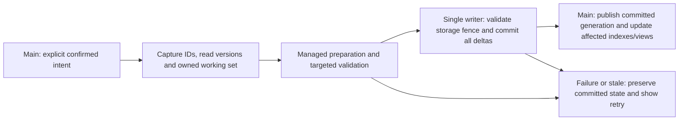

# Save, state and memory refactor — review plan

Date: 2026-10-23. **Planning only. No checkpoint below is implemented or authorized for execution by this document.** The user requested review before implementation. The separate shifter appearance request does not authorize this refactor.

## Goal and relationship to the existing plan

Make definitive actions transactional and responsive as collections grow. Keep one authoritative in-memory state, stable component identities, incremental indexed reads, bounded private working sets and one ordered durable writer. Use workers for audited managed computation and storage; keep Unity access and live state publication on main. Faster code and smaller work come before adding concurrency.

This is the execution/agent breakdown of [ARCHITECTURE_PERFORMANCE_PLAN.md](ARCHITECTURE_PERFORMANCE_PLAN.md), not a competing rewrite. Preserve its correctness contracts and [storage direction](SAVE_STORAGE_DIRECTION.md). The earlier AP document contains historical PR/approval status; re-establish the current baseline in S00 rather than automatically repeating or declaring those gates complete. The user now explicitly asks for a plan using several **Luna agents at medium reasoning**. No agents have been launched for this plan.

Implementation, when separately authorized, proceeds **one checkpoint at a time**. Parallel agent work is limited to disjoint subtasks inside that checkpoint. Each checkpoint ends with checks, a runnable build where appropriate, a local commit, measurements and a ledger update. Do not interpret the whole backlog as authorization. User acceptance and technical completion remain separate.

## Current evidence — distinguish progress from remaining work

Code inspected on local `main` after `25b1bd8`; preserve unrelated local report changes and attachments. No checkout, merge, push or worktree is part of this planning request.

| Area | Already present | Remaining cost / constraint |
| --- | --- | --- |
| Persistence | SQLite schema v2, migrations/checksums, WAL/FULL durability, storage commit fences, ownership relations, backups and reset recovery | `ProfileStore.TrySaveCore` still waits on `Task.Run(...).GetAwaiter().GetResult()`. Moving the write to a task alone does not free the caller. |
| Commands | `MechanicsTransactions.Try` checks expected revision and persists before publishing | It JSON-clones the whole profile and calls `MechanicsOwnership.Ensure` before and after an operation. Small actions still traverse unrelated state. |
| Row projection | `StateRows` splits and reuses unchanged payloads; SQL writer updates changed records | Its ordinary capture begins with complete `JsonUtility.ToJson(profile)`; relationship synchronization still has whole-state work. Existing row deltas are progress, not scoped commands. |
| Race completion | Staged settlement, managed save preparation, resource checkpoints and exact-once safeguards | Reuse and later unify these paths. Preserve newer shutdown condition/fuel and independent rival timing; do not replace race simulation. |
| Lookup/cache | `RuntimeIndexSlot`, market fitment indexes, inspection/preview caches, typed mechanical stress lookup | Many ownership/member scans remain. Revision-wide invalidation and detached copies still require measurement. A read-only wrapper alone does not make mutable data safe to share. |
| Recent performance | Class probe 777→382 ms; static inspection 10.76→1.98 ms; 24 display sale values 46 ms versus 3,782 ms for binding quotes | Historical desktop examples from [the measured report](../reports/commerce-performance-20261022/CHANGES.md), not new benchmarks or phone guarantees. A durable runtime purchase still measured 760 ms. |
| Branch history | Current checkout is main and contains fitment work | Historical reviewed PR head `1ac43cc` is not an ancestor of current HEAD. That alone does not distinguish equivalent integrated changes from missing work. S00 must map actual content/history before any merge decision; do not merge an old PR blindly. |

## Target state and memory ownership

1. **Authored catalogue:** immutable managed definitions/indexes shared by content revision. Capture Unity assets on main once. Keep private mutable resolver/simulation scratch; never share mutable dictionaries merely because they belong to a catalogue.
2. **Committed state:** stable-ID cars, engines, parts, individual members, locations, stock, reservations, balances, progression and receipts. One state owner publishes a new committed generation. Queries do not normalize, repair, serialize or save it.
3. **Runtime indexes:** by ID; owner/slot; member/position; location; product/seller/epoch; reservation source. Maintain affected entries with the same published generation. Preserve domain ordering and distinguish canonical products from physical instances. SQL indexes do not speed up `List.Find` in memory.
4. **Command working set:** explicit read dependencies, copied mutable records, creations/deletions, ledger/resource deltas and expected versions. Untouched records may be shared only when immutable to every participant. Choose aggregate granularity from measured write patterns; do not create a full-profile clone disguised as a snapshot.
5. **Derived views:** bounded read-only inspection/dyno/class/price summaries keyed by physical inputs and relevant content. Cash, names and unrelated cart changes should not invalidate engine physics. Wear, fluids, installed hardware and tune must. Never reuse a display price as payment authority.
6. **Simulation:** active race owns its existing live physical state. Capture necessary immutable inputs or resource deltas at established boundaries. Do not replace the physical model with preview estimates or perform SQL per tick.

Memory budgets must include catalogue copies, indexes, retained generations, captured jobs, preview caches, row payloads, SQL buffers and backup buffers. Limit in-flight captures and release them on completion/cancellation. A bounded queue of enormous snapshots is still too expensive. No blanket object pooling: use reusable numeric/buffer scratch where profiling justifies it; never return published/read-only state to a pool while readers still own it.

## Transaction contract

- Command identity includes save slot, reset generation and operation ID. Capture quote/content/pricing versions, quantities, real member positions, stock epoch and reservation dependencies where relevant. Do not let an old command enter a new save/reset generation.
- Define one atomic write set for one confirmed logical action: money, stock, actual ownership, member condition, holds, receipts and progression all succeed or fail together. Never save each cart line independently.
- Main captures a consistent owned snapshot; workers never traverse the mutable live profile. A final compare/rebase policy must cover both memory and storage versions. Initially reject conflicting stale commands; do not silently reprice or substitute items.
- One writer owns connection/transaction lifetime, reusable statements and durable acknowledgement. Keep WAL/FULL, constraints, commit tokens and migration safeguards. No success or spendable reward before durability.
- Pre-commit cancellation may discard preparation. After COMMIT, cancellation cannot undo or hide the command: reconcile by operation receipt and publish/reload the durable outcome even if its original screen closed. A timeout is not proof of rollback.
- Stage publication before writing so the final main-thread publish is bounded and cannot discover avoidable validation errors. If publication still fails after COMMIT, stop conflicting actions and reconcile the durable result; never report a rolled-back purchase.
- Pending UI shows progress with existing styling, blocks double confirmation and conflicting mutations, and preserves drafts and held driving input. Pure browsing can continue over the last committed view.
- Checkpoint/resource writes, purchases, backups, migrations and resets must coordinate through the same storage ownership/fences. Cheap scheduling priorities must not reorder resource dependencies or starve a definitive save.

## Worker boundaries and scheduling

| Work | Main / Unity ownership | Eligible background work |
| --- | --- | --- |
| Assets, UI, controls, AudioSource lifecycle | Unity access and main-thread publication | None of those APIs |
| Catalogue/index construction | Capture asset values and content revision | Audited pure managed immutable indexes |
| Command planning / pricing / validation | Capture owned dependencies and present errors | Managed working-set preparation; keep very cheap commands synchronous if measured faster |
| SQL, encoding, backup I/O | Enqueue, observe completion, lifecycle coordination | One ordered writer; bounded backup scheduling, never a second unsynchronized save writer |
| Physics previews, class/HP sorting | Capture physical fingerprint; display completed results | Existing authoritative simulation on isolated captured data; bounded reusable results |
| Market generation | Capture exact seed/epoch/ownership/coverage; publish complete stock | Existing deterministic streams and pure managed preparation; no RNG reroll on cancellation |
| Live race and DSP | Preserve current simulation ownership and dedicated audio callback | No new general job dispatch, locks, file I/O or allocation in the DSP callback |

Start with one preparation lane plus the storage writer; select actual worker limits from Android measurements. Coalesce replaceable preview requests, cancel obsolete work cooperatively and discard stale results. Never coalesce away a confirmed command. Bound queue size and memory before capturing input, and expose backpressure without freezing the UI. Native crash/suspend timing is not a guaranteed opportunity for an arbitrary synchronous flush: retain already durable receipts and the existing resource journal, and test forced termination.

## Database evolution

Keep authored content in project assets and settings in their separate recoverable file. Preserve schema, build, content and physics/replay version distinctions. Prefer direct deltas against existing tables first; normalize another hot family only when its actual projection/query cost justifies a migration.

| Record family | Intended authoritative representation |
| --- | --- |
| Cars / engines / parts | Stable identities, ownership/location and installed-slot relations; augment existing tables rather than create competing ledgers |
| Tires / pistons / valves and other members | Exact member identity/position, specification, condition and applicable fault type; no averaged replacement for individual state |
| Stock / discovery / reservations | Seed/epoch, canonical product, delivered/free/held units and exact source/expiry; preserve used listings and new-supply behavior independently |
| Balances / progression / receipts | Transactional deltas plus idempotent operation receipts and exact-once race/business outcomes |
| Fluids / wear / checkpoints | Quantities and cumulative history, run ID/tick, monotonic resource advance; no healing during normalization or late publication |
| Cold history / flexible payloads | JSON may remain when not on the hot path; avoid repeated global serialization just to change one record |

New migrations append immutable versioned scripts, create recoverable backups, convert/validate transactionally and refuse future schemas safely. Include legacy import, reset floors, corrupt-primary recovery and missing-content policy. Never replace player data with authored defaults, invent removed OEM parts, change IDs or clear faults to pass validation.

## Planned Luna-medium team

Use **`gpt-6-luna`, reasoning `medium`**, for every delegated implementation/review agent. The coordinating agent keeps the human-reviewed contracts and final integration responsibility. The current tool limit is four concurrent agents total: coordinator plus **at most three Luna workers**. Do not spawn the entire roster at once. No worktrees unless the user later changes that instruction.

| Worker role | Primary ownership when assigned | Must not edit |
| --- | --- | --- |
| L1 — state/domain | New state/index/command DTOs, scoped planners and targeted invariants in the explicitly assigned files | SQLite migration/writer internals, UI, another worker's files |
| L2 — persistence | Assigned row projection/delta writer, migration or recovery adapter after contract agreement | Live domain/UI mutations or a new parallel canonical state |
| L3 — verification/views | Independent equivalence/failure/load fixtures; or one assigned cache/UI consumer after its test contract is pinned | Production files owned by L1/L2; do not weaken golden assertions to fit output |

The coordinator owns shared entry points, contract changes, git staging/commits, final builds, report and acceptance ledger. Freeze an exact file/contract ownership manifest before launching workers; a filename may have only one writer. Unanticipated shared edits go back to the coordinator and are serialized. Workers report evidence and diffs; they do not merge, reset, push or advance checkpoints.

For cross-cutting changes rotate L3 into an independent reviewer after the implementation is integrated, rather than asking an author to approve their own result. Agent concurrency is for development only; it is unrelated to runtime thread count.

### Delegation template for every checkpoint

Give the worker: checkpoint ID and single outcome; baseline commit; model/effort; allowed paths and read-only dependencies; input/output types and invariants; forbidden semantic changes; exact fixtures and performance workload; expected report; stop conditions. Require actual commands/results, unresolved concerns and no invented passes. If the local tool cannot provide the requested Luna model/medium effort, report it instead of silently substituting a model.

## Ordered checkpoints and agent split

Each row is a reviewable increment. Rows with several command families are a backlog: execute **one named suffix only**, with its own commit, before the next. A checkpoint may use fewer than three workers when dependencies make parallelism unsafe.

| Step / AP mapping | Deliverable | Luna allocation and dependency | Gate before proceeding |
| --- | --- | --- | --- |
| **S00 / AP00–02** | Current architecture/caller map, PR-content/history disposition and reproducible timing/allocation baseline; no runtime behavior change | L1 maps mutable graph/lookup/clone costs; L2 maps projection/SQL/locks/recovery; L3 builds independent workload and existing-test inventory. Read-only audits may run together; coordinator decides what is already integrated. | Same seeds, profile, stock, reservations and inputs; cold/warm repeats on Windows and Android where available. Record untouched existing failures. No automatic merge or claim all PR gates passed. |
| **S01 / AP04** | Frozen command/read-write/version/receipt and state-ownership contracts; thin dormant adapters | L1 contracts; L2 storage mapping review; L3 failure matrix. Coordinator owns existing entry-point wiring; do not switch gameplay yet. | Explicit invariant coverage and no new persistent authority. Local contract tests; existing saves/load stay equivalent. |
| **S02 / AP03** | One runtime identity/ownership index family and candidate-local update semantics | L1 production index; L3 differential scans/duplicate-orphan tests; L2 reviews transaction impact. | Same lookup results and rejection as scans; index cannot become stale during a mutable candidate. Measure lookup, build and retained-memory cost. Then add next index family as S02b, etc. |
| **S03 / AP05** | One immutable authored view or dependency-specific cache at a time | L1 snapshot lifetime; L3 consumer/cache equivalence; L2 only audits memory/storage boundary. Disjoint paths required. | Cash/name edits reuse physical results; actual wear/fluid/tune/hardware changes invalidate. Bound capture and cache memory; cancellation cannot publish stale data. |
| **S04 / AP06** | One fluid refill planner with a private scoped working set, shadowed against legacy | L1 planner/invariants; L3 independent golden and randomized parity; L2 designs affected-row projection without switching writer. | Same price, capacity, fluids/history, IDs and errors; committed source unchanged on every failure. Full-validator agreement on valid and corrupted fixtures. No whole-profile mutating Ensure over shared records. |
| **S05 / AP07** | Direct row deltas for that same pilot, using existing schema where practical | L2 writer/projection; L1 planner dependency corrections; L3 SQL fault/crash/logical reload comparisons. Freeze the delta contract first. | Atomic cash+fluid+receipt; affected-row writes, no unrelated projection/relationship scans; caches update only after COMMIT. Old/new logical reload parity, forced failure at each stage. |
| **S06 / AP08** | Single pending-command coordinator and nonblocking pilot integration | Coordinator main/UI integration; L2 ordered writer/acknowledgements; L1 immutable transport; L3 real held-writer/double-click/navigation/suspend tests. Serialize interface edits. | UI keeps responding under writer delay; no GetResult/Wait on ordinary UI path, false success, lost durable result or stale settings overwrite. Record final-frame publication cost. |
| **S07 / AP09** | One atomic complete-cart checkout, preserving partial stock and express delivery | L1 cart planner; L2 scoped persistence; L3 differential and failure tests after contract freeze. Reservation edits are S07b if separately needed. | Exact money/fee/stock/hold/member/removed-original parity, nine-race reservations, no duplicate checkout after retry/restart. No per-line save. |
| **S08 / AP10** | One maintenance action through existing cart/stock planner | Start S08a Replace broken, then S08b Replace under X%. L1 planner adapter; L3 selection/member/threshold tests; L2 audits complete delta. | Common slider retained; stable drag layout; correct partial-stock express counts/fees and exact selected members. Preserve removed faults/wear; one logical transaction. |
| **S09 / AP11** | Inventory/workshop, one named command per suffix | S09a move; b individual member install/swap; c rebuild; d prepared-engine swap; e sale. L1 one command; L2 needed delta support; L3 topology/rollback/real-flow tests. | Exclusive locations/ownership, matching rules, exact member positions, engine fluids and histories; sale quote authority and recovery guards retained. No new normalization or fabricated missing parts. |
| **S10 / AP12** | Remaining commands one at a time | Tune Apply, setup load, vehicle purchase, vehicle sale, race entry, business claim/expansion, reset each get their own suffix and owner manifest. | Existing confirmations, quote staleness, funds/resources, saved preferences and exact-once progression remain. Reset must fence/drain/cancel old generations safely. |
| **S11 / AP13–14** | Schema review first, then at most one approved hot record family per migration | L2 schema/query-plan/migration proposal; L1 domain mapping; L3 independent import/recovery fixtures. **Separate review gate before migration implementation.** | Measured need, canonical field authority, indexes/constraints, compatibility and rollback policy. Versioned fixtures, backup/reset/future-schema tests. No wholesale default-content migration. |
| **S12 / AP15** | Coordinate existing race checkpoints/settlement and deterministic market preparation with command writer | L1 monotonic state merge; L2 writer ordering/checkpoint retirement; L3 race/finish/forced-kill contention tests. Keep live race ownership unchanged. | Correct winner/timing, once-only reward and three-race market epoch; later shutdown wear/fuel survive; no stock reroll, UI/other-car teleport or audio starvation. Early quit before rival finish remains valid. |
| **S13 / AP16** | Remove only converted legacy bridges and duplicate normalization/caches | Assign each obsolete path to one owner; independent L3 review. Coordinator verifies all callers before removal. | No obsolete caller, dual write or new fallback silently reintroduces full cloning. Keep load/import/migration full validation and independent golden references. |
| **S14 / AP17** | Whole-system soak, scaled memory/performance comparison and final builds | L1 state/leak audit; L2 durability/recovery audit; L3 packaged input/frame/audio tests, run interactively one at a time. Coordinator releases builds. | Windows and Android, actual phone when available, exact workload parity, crash/restart and long-session evidence. Explicit remaining limits and user review. |

## Measurements and correctness gates

S00 fixes disposable workloads at 1/5/20 owned cars and increasing loose-member/stock/history counts. Include fuel/oil/coolant service, stock+express checkout, cart edits, worn replacement, inventory move, rebuild/swap/sale, setup/tune, market-refresh race settlement, business claim, reset/load and recovery. Pin input hashes, content/physics revisions, seed/stream, epoch, reservation clock, settings, hardware and frame cap. Do not assume invented timings.

Record warm/cold samples and distribution (median/p95/p99/max with sample count), main-thread busy time, visible input/frame delay, worker CPU and queue wait, SQL prepare/write/durable flush, rows read/written, bytes cloned/projected, GC allocations/collections and peak/retained memory. Distinguish CPU improvement from merely spreading work over more frames. Compare at equal physical fidelity and generated stock. Trace capture, validation, durable acknowledgement and publication separately.

Provisional goals to validate against devices: ordinary main-thread capture/publication roughly 2–3 ms per chunk; responsive feedback within the next rendered frame; no transaction-caused >50 ms UI stall under representative load; small command work proportional to its dependencies rather than total unrelated inventory. These are **targets, not current guarantees**. S00 records feasible device-specific budgets; slow storage may increase pending duration while input remains responsive. A target miss must be reported, not hidden by omitting tail frames.

Required correctness matrix:

- Exact legacy/new output parity for successful commands and rejection parity for invalid/stale quotes; expected semantic changes require separate authorization.
- Current schema, each supported migration/import, missing/corrupt primary+backup, future-schema refusal, reset-generation fences and restart at each transaction stage.
- Injected SQL/write/flush failure, writer contention, duplicate operation IDs, cancellation, view closure, process death before/after COMMIT and publication failure reconciliation.
- Partial stock, active holds, express fees, seeded used/new markets, discovery and full-set/member quantities remain exact. New-supply rules never leak into used generation.
- Mixed tires/pistons/etc, proper component fault types, exact condition/fluids and cumulative resource history; no heal or double ownership.
- Late race resource ticks versus settlement, two finish orders, missed starts/quick leave, reward idempotency, early exit, settings draft preservation and held mobile throttle through shifts.
- Long-session navigation, sort/filter churn and worker cancellation release captures/index generations; audio callback underruns and mobile thermal throttling are observed, not assumed absent.

Run existing targeted SQLite/state, valuation, cart/purchase, maintenance/rebuild, workshop, market, finish, recovery and native interaction suites appropriate to each step. Inventory their exact entry points in S00; report stale fixtures separately and fix independently instead of skipping a blocked suite. Documentation-only planning needs static checks, not another full simulation build.

## Review ledger

| Item | Technical status | Human approval |
| --- | --- | --- |
| This file / agent breakdown | Written for review; static links/encoding/diff checked before commit | Awaiting review |
| S00–S14 | **Not started** | Not authorized by this planning request |
| Proposed typed schema/migrations | Proposal boundaries only | Explicit review before S11 implementation |

For every future completed checkpoint record: baseline/result commit, exact allowed files/agent assignments, tests/builds actually run, before/after metrics, memory/thread ownership, failure/recovery evidence, remaining costs and acceptance. Update one next-step pointer. Do not mark a step complete because an agent finished or automation passed while required work is still pending.
